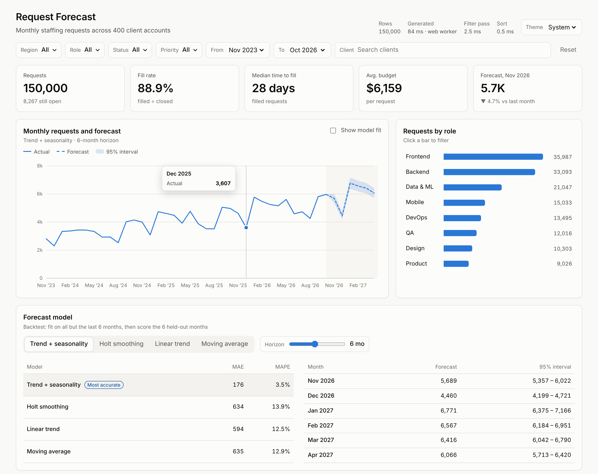

# Request Forecast Dashboard

A React dashboard for a platform that handles **monthly staffing requests**. It generates 150,000 requests from 400 client accounts, lets you slice them in real time, and forecasts next months' volume with four client-side models that are scored against each other on held-out data.



## Quick start

One command, with Docker:

```bash
docker compose up -d --build   # then open http://localhost:8080
```

Or with Node:

```bash
npm install
npm run dev      # http://localhost:5173
npm test         # 45 unit + component tests (Vitest, Testing Library)
npm run build    # production build in dist/
```

No backend and no API keys: the data is generated in the browser from a fixed seed, so every run shows the same numbers.

## Self-hosting on your own machine

The app is a static site, so it runs anywhere that can serve files. Pick the option that matches what you have installed.

### Option A: Docker (recommended)

You need [Docker Desktop](https://www.docker.com/products/docker-desktop/) on macOS or Windows, or Docker Engine with the Compose plugin on Linux.

1. Get the code:
   ```bash
   git clone https://github.com/Khalil002/request-forecast-dashboard.git
   cd request-forecast-dashboard
   ```
2. Build and start it:
   ```bash
   docker compose up -d --build
   ```
   This installs dependencies, **runs the test suite** (the build stops if a test fails), builds the bundle and serves it with nginx. The final image is about 75 MB.
3. Open **http://localhost:8080**.

Day-to-day commands:

| Task | Command |
|---|---|
| Use another port | `PORT=3000 docker compose up -d --build` |
| See logs | `docker compose logs -f` |
| Stop | `docker compose down` |
| Update to the latest code | `git pull && docker compose up -d --build` |

The container restarts automatically after a reboot (`restart: unless-stopped`) and has a health check, so `docker compose ps` shows whether it's healthy.

To reach it from other devices on your network, use your machine's LAN IP, for example `http://192.168.1.20:8080`, and allow the port through your firewall.

### Option B: Node.js only

You need Node.js 20 or newer (`node -v` to check).

```bash
git clone https://github.com/Khalil002/request-forecast-dashboard.git
cd request-forecast-dashboard
npm ci
npm run build
npm run preview -- --host --port 8080   # serves dist/ at http://localhost:8080
```

`npm run preview` is fine for personal use. For anything long-running, use Option A or Option C.

### Option C: Any static web server

`npm run build` writes plain HTML, CSS and JS to `dist/`. Copy that folder to any static host or web server (nginx, Apache, Caddy, GitHub Pages, Netlify and so on). Asset paths are relative, so it also works from a sub-path like `example.com/dashboard/`. [`nginx.conf`](nginx.conf) is a ready-made server block with gzip and caching.

### Troubleshooting

- **Port already in use**: pick another one with `PORT=3000 docker compose up -d --build`.
- **`npm ci` fails during the Docker build**: the build needs internet access to reach the npm registry. Check your proxy or VPN settings.
- **Blank page when opening `dist/index.html` directly**: browsers block module scripts and Web Workers on `file://`. Serve the folder over HTTP with one of the options above.

## What it does

- **Filters** by region, role, status, priority, month range and client name. All of it runs in a single pass over 150k rows in about 3 ms.
- **KPIs**: request count, fill rate, median time to fill, average budget and next month's forecast against last month.
- **Trend chart**: three years of monthly volume, the forecast as a dashed continuation, and a 95% prediction interval. Hover or use the arrow keys for a crosshair tooltip.
- **Role breakdown**: horizontal bars that also work as a filter (click a bar).
- **Forecast model panel**: choose between trend + seasonality, Holt smoothing, linear trend and moving average, and pick a horizon from 1 to 12 months. A backtest table shows MAE and MAPE for each model on the last 6 months it never saw.
- **Request table**: all 150k rows, sortable on every column. It's virtualized, so only about 20 rows are in the DOM at any time.
- Light and dark themes, a keyboard-friendly layout and phone-width support.

## Tech highlights

| Area | How it's done |
|---|---|
| React | Function components and hooks on React 19: `useSyncExternalStore`, `useDeferredValue`, `React.lazy`/`Suspense`, `memo` ([`src/components`](src/components)) |
| State management | A hand-written Flux/Redux-style store with a single state tree, a pure reducer, action creators and subscribers ([`src/store`](src/store)), plus Reselect-style memoized selectors ([`memoize.js`](src/store/memoize.js)) |
| Predictive analytics | OLS regression, Holt exponential smoothing, a seasonal decomposition, prediction intervals and backtesting ([`forecast.js`](src/analytics/forecast.js)) |
| Off-main-thread work | The dataset is generated in a **Web Worker**, and its column buffers come back to the UI as zero-copy *transferables* ([`dataset.worker.js`](src/data/dataset.worker.js)) |
| Client-side performance | Virtualized rows, memoized selectors, deferred rendering, code splitting, an O(1) lookup table per filter dimension, and a counting-sort median. The header shows live timings |
| Data structures | Dictionary-encoded typed-array columns (`Uint8Array`, `Uint16Array`, `Float32Array`), index arrays instead of copied rows, and binary search for weighted sampling ([`random.js`](src/data/random.js)) |
| HTML, CSS and JavaScript | Modern ES modules, hand-rolled SVG charts, CSS custom properties for theming, CSS grid, `:has()`, semantic HTML and ARIA roles |
| Testing and CI | 45 Vitest + Testing Library tests covering the pure functions, the reducer, selectors and components, plus a GitHub Actions workflow ([`.github/workflows/ci.yml`](.github/workflows/ci.yml)) |
| Tooling and deploy | Vite, npm scripts, and a one-command Docker deploy ([`Dockerfile`](Dockerfile), [`compose.yaml`](compose.yaml)) |

## Architecture

```
            ┌──────────── Web Worker ────────────┐
            │ generateDataset(seed) → typed arrays│
            └──────────────┬─────────────────────┘
                           │ postMessage (transfer buffers)
                           ▼
 UI events ─► actions ─► reducer ─► store state { dataset, filters, sort, forecast, theme }
                                         │
                       useDeferredValue  │  useSyncExternalStore
                                         ▼
                 memoized selectors (recompute only on new inputs)
       filterRows → sortRows → computeKpis / monthlyCounts → forecast + backtest
                                         │
                                         ▼
        KPI tiles · TrendChart (SVG) · CategoryBars · ForecastPanel (lazy) · VirtualTable
```

**Why columns instead of objects?** 150k objects with 10 fields each means about 1.5M properties for the garbage collector to track. Storing typed-array columns keeps it to about 3 MB of flat memory. That data can be transferred from the worker without copying and scanned in a tight loop. Filtering returns a `Uint32Array` of row indices, so sorting and virtualization move integers around and never copy rows.

**Why the forecast ignores the month-range filter.** Narrowing the visible window shouldn't starve the model of history. The month range zooms the KPIs, the table and the shaded chart area, while the forecast always fits on full history with the other filters applied. Its selector depends on the individual filter fields, so changing the date range never re-runs the models.

## Forecasting models

| Model | Idea | Interval |
|---|---|---|
| Trend + seasonality | Fits a line, estimates 12 multiplicative month indices, refits on the de-seasonalised series and re-applies the indices | Residual SD scaled by the seasonal index |
| Holt smoothing | Exponentially smoothed level and trend (α = 0.5, β = 0.2) | Widens with the horizon |
| Linear trend | OLS on time | Exact OLS prediction interval |
| Moving average | Mean of the last 3 months, flat forecast | √h random-walk widening |

The generated data has real seasonality (January ramp-up, summer and December dips), so the backtest shows trend + seasonality winning clearly, at about 3.5% MAPE against about 13% for the others. Making that visible is what the panel is for.

## Project layout

```
src/
  data/        seeded PRNG, schema, generator, Web Worker + loader
  analytics/   filter, aggregate, sort, forecast (pure functions + tests)
  store/       createStore, actions, reducer, selectors, React bindings
  components/  dashboard, filters, KPIs, charts, virtual table, forecast panel
```

## License

MIT
